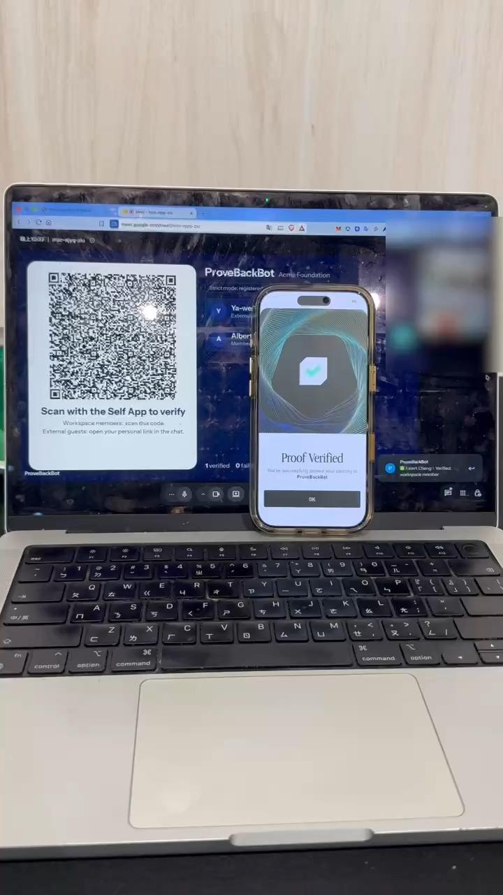

# ProveBackBot

A hackathon prototype that verifies the identity of Google Meet attendees with passport zero-knowledge proofs (Self Protocol).

## Demo

▶️ [30-second demo video](docs/demo.mp4): member onboarding → create a meeting → send the bot into Google Meet → the list shows the verification result as soon as the QR code is scanned.

The console (workspace policy, member passport binding status, meeting creation):

### Scanning with the Self App on a phone

▶️ [24-second phone video](docs/phone-demo.mp4): scan the onboarding QR to bind a passport (the console shows "Passport bound"), then scan the QR on the bot's screen during the meeting. The phone shows "Proof Verified" and the Meet list gets its check mark right away.

## Project structure

- `public/index.html`: console (workspace policy, member onboarding, meeting creation, sending the bot, simulated testing)
- `public/bot-screen.html?m=<meeting ID>`: the bot's camera feed (QR code + live list), streamed into the meeting by Recall.ai
- `public/s.html?s=<session>`: personal verification page for external guests and onboarding
- `api/verify.js`: endpoint that receives proofs from the Self App (`SelfBackendVerifier`)
- `api/bot.js`, `api/recall-webhook.js`: the Recall.ai bot and participant-join events
- `api/simulate.js`: simulation endpoint for testing without the Self App

## Environment variables

| Variable | Description |
|---|---|
| `BLOB_READ_WRITE_TOKEN` | Vercel Blob (created automatically when a Blob store is connected). Without it, state is kept in memory, which is only suitable for local testing |
| `RECALL_API_KEY` | Recall.ai API key (required to send the bot) |
| `RECALL_REGION` | Recall region, defaults to `us-east-1` |
| `SELF_MOCK` | Defaults to `true`: accepts mock passports from the Self App; set to `false` for real passports |
| `SELF_OFAC` | Requires an OFAC check when `true` |
| `SELF_SCOPE` | Self scope, defaults to `provebackbot-demo` |
| `PUBLIC_BASE_URL` | Public URL; defaults to the Vercel production domain. It determines the Self endpoint, so the QR code and the verifier must agree when the domain changes |
| `ALLOW_SIMULATE` | Set to `false` to disable the simulation endpoint (always disable it in production) |

## Verification rules

- Shared member QR: the nullifier is matched against the member bound during onboarding; no match in strict mode → ✕
- Personal QR for external guests: nationality must not be on the restricted list, (optionally) OFAC, and the passport name must contain every word of the meeting display name
- One passport can only pass one seat per meeting

Nationality restrictions are checked on the backend using the disclosed nationality. The upside is that a rejection can show its reason; the cost is that the backend sees the nationality.
This could later move to the `excludedCountries` check built into the Self circuit, so the backend only learns "not on the list".
