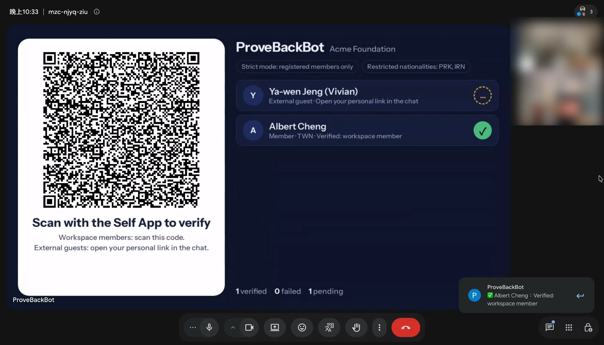
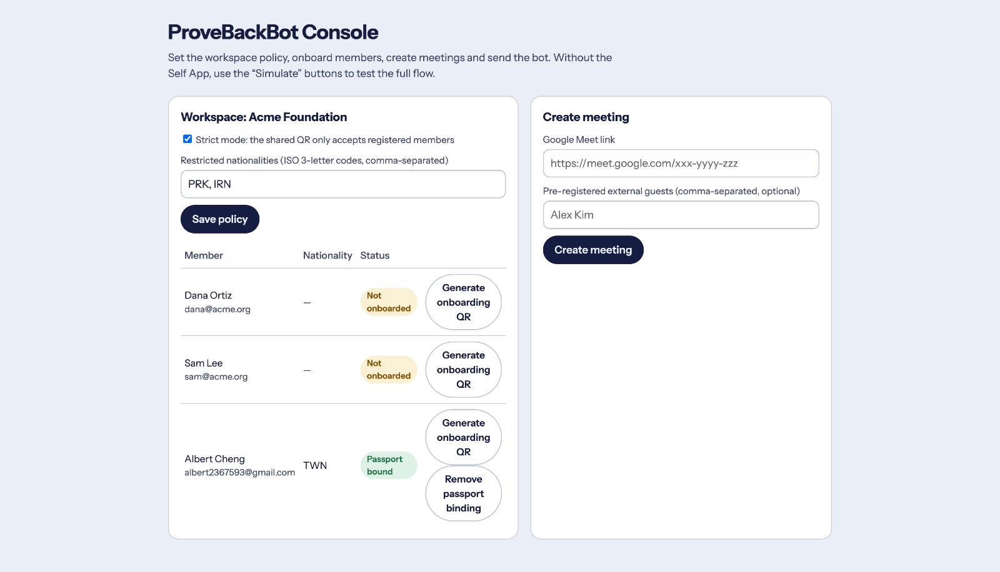

# ProveBackBot

用護照零知識證明（Self Protocol）驗證 Google Meet 與會者身分的黑客松原型。

## Demo

▶️ [30 秒示範影片](docs/demo.mp4)：成員 onboarding → 建立會議 → 派 bot 進 Google Meet → 掃 QR 後名單即時顯示驗證結果。

控制台（workspace 政策、成員護照綁定狀態、建立會議）：

## 專案結構

- `public/index.html`：控制台（workspace 政策、成員 onboarding、建立會議、派 bot、模擬測試）
- `public/bot-screen.html?m=<會議ID>`：bot 的鏡頭畫面（QR code + 即時名單），由 Recall.ai 串流進會議
- `public/s.html?s=<session>`：外部與會者／onboarding 的專屬驗證頁
- `api/verify.js`：Self App 回傳證明的端點（`SelfBackendVerifier`）
- `api/bot.js`、`api/recall-webhook.js`：Recall.ai 機器人與參與者加入事件
- `api/simulate.js`：不用 Self App 也能測試的模擬端點

## 環境變數

| 變數 | 說明 |
|---|---|
| `BLOB_READ_WRITE_TOKEN` | Vercel Blob（連接 Blob store 時自動建立）。沒有時改用記憶體，只適合本機測試 |
| `RECALL_API_KEY` | Recall.ai API key（派 bot 必填） |
| `RECALL_REGION` | Recall 區域，預設 `us-east-1` |
| `SELF_MOCK` | 預設 `true`：接受 Self App 的 mock passport；正式護照設 `false` |
| `SELF_OFAC` | `true` 時要求 OFAC 檢查 |
| `SELF_SCOPE` | Self scope，預設 `provebackbot-demo` |
| `PUBLIC_BASE_URL` | 對外網址；預設用 Vercel 的正式網域。Self 的 endpoint 由它決定，換網域時 QR code 與驗證端必須一致 |
| `ALLOW_SIMULATE` | 設 `false` 關閉模擬端點（正式環境務必關閉） |

## 驗證規則

- 成員共用 QR：用 nullifier 對應 onboarding 時綁定的成員；對不上且 strict mode → ✕
- 外部與會者專屬 QR：國籍不在受限名單、（可選）OFAC、護照姓名需包含會議顯示名稱的每個字
- 同一本護照在同一場會議只能讓一個席位通過

國籍限制在後端用揭露的國籍判斷，好處是被擋下時能顯示原因；代價是後端會看到國籍。
之後可改用 Self 電路內建的 `excludedCountries`，讓後端只知道「不在名單內」。
